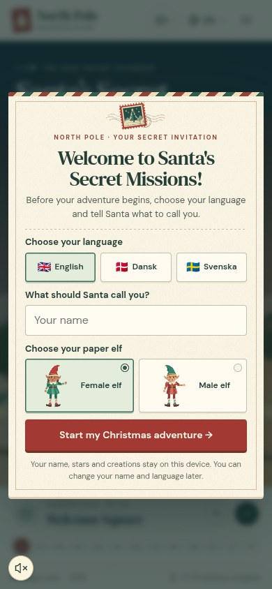

# Santa’s Secret Missions • Village preview

New visitors receive a paper invitation to choose English, Danish or Swedish, enter a name and select a female or male paper elf. The original letter and Golden Rules follow. Returning visitors arrive in the village with their saved puppet. Both designs are available in the village menu. [Open the independent preview](https://santas-paper-village-preview.tonie81.chatgpt.site)




## Review the experience

- Drag, swipe, scroll or use the arrow keys to turn the camera. The route wraps from the Christmas Palace directly to Welcome Square in either direction.
- Try a sealed door to see the padlock rattle, snow slide from the roof and the elf react. An available door opens into the existing mission panel. Close it to return to the same view.
- Complete a mission to hang a gold star and festive trim on its house. Saved creations, hints, completion and undo use the original workbench.
- The speaker starts muted. It switches the original synthesized celesta melody and short interaction sounds on or off. A speaker remains reachable inside dialogs.
- Use **Village menu → Classic calendar** for the original layout. It also opens automatically when WebGL is unavailable. Sustained slow frames expose a direct classic-calendar link in the route footer.

The preview uses a separate origin, IndexedDB database names, localStorage keys and a scope-specific cache prefix. It stores names, stars, language and creation files on the visitor’s device. Owner mode uses its own progress and creation records. [Classic preview](https://santas-paper-village-preview.tonie81.chatgpt.site/?view=classic)

## Owner testing before December

Tap the small decorative **crescent moon** at the upper right of the welcome invitation five times within three seconds. After onboarding, return to **Welcome Square** and tap its hanging crescent moon five times within three seconds. The trigger follows the visible moon as the camera moves; the former bottom-right hotspots have been removed. The page reloads into owner test mode, which opens all twelve doors. On a fresh device, complete the invitation in test mode.

To exit, open **Village menu → Owner test · Return to real calendar**. If the welcome invitation is open, use its **Owner test · Return to real calendar** control. Normal dates and saved progress return after reload. The owner flag, normal and test progress, and normal and test creation databases stay local to the device.

## Before and after

| View | Previous build | Refined build |
| --- | --- | --- |
| Welcome Square | [Desktop](before/welcome-desktop.jpg) · [Mobile](before/welcome-mobile.jpg) | [Desktop](welcome-desktop.jpg) · [Mobile](welcome-mobile.jpg) |
| Gingerbread Cottage | [Earlier framing](before/stop-01.jpg) | [At the door](stop-01.jpg) |
| Between neighbouring stops | | [Wide view on desktop](between-sectors.jpg) · [Mobile paper seam](mobile-seam.jpg) |
| Puppet selection | | [Both designs in the invitation](invitation-desktop.jpg) · [Male elf in the village](male-paper-elf.jpg) |

The inspiration recording shows adjacent pieces of coloured ground and contrasting vertical backdrops in the same frame. The revised village uses thirteen individually coloured wedges, layered kraft edges, folded silhouettes and a continuous walking ribbon. The animated elf is built from hinged sheets with printed facial details. The dedicated ground shadow was removed. Approaching a sector center narrows the field of view. Halfway to the next center, the lens widens by 13 degrees on mobile and 8 degrees on desktop. Reduced-motion mode keeps the exploration lens steady.

## Run locally

Use Python 3 to build the self-contained static site. The build includes Three.js, fonts, licenses, village modules and the original calendar. No package installation is required to serve it.

```sh
git clone --branch experimental/3d-christmas-village --single-branch https://github.com/tonielar/santas-secret-missions.git
cd santas-secret-missions
python3 scripts/build.py
python3 -m http.server 8000 --bind 127.0.0.1 --directory dist
```

Open `http://127.0.0.1:8000/`. The classic view is at `/?view=classic`. To review the locally unlocked development build, serve the repository root with `python3 -m http.server 8001 --bind 127.0.0.1` and open `http://127.0.0.1:8001/dev/test.html`. The generated single-file development download opens the original calendar offline. The hosted artifact contains only the allowlisted production-mode shell.

## Rendered screenshots

| Welcome and mission screens | Houses 1–6 | Houses 7–12 |
| --- | --- | --- |
| [Welcome Square on desktop](welcome-desktop.jpg) | [Gingerbread Cottage](stop-01.jpg) | [Aurora Cabin](stop-07.jpg) |
| [Mobile viewport](welcome-mobile.jpg) | [Winter Forest](stop-02.jpg) | [Snowman Cottage](stop-08.jpg) |
| [Original mission panel](mission-panel.jpg) | [Frostglass Hall](stop-03.jpg) | [Reindeer Lodge](stop-09.jpg) |
| [Interactive creation preview](creation-preview.jpg) | [Christmas Bakery](stop-04.jpg) | [Candy Shop](stop-10.jpg) |
| [Completed house](completed-forest.jpg) | [Elf Workshop](stop-05.jpg) | [Star Observatory](stop-11.jpg) |
| | [Lantern Market](stop-06.jpg) | [Christmas Palace](stop-12.jpg) |

## Browser and build checks

The automated suite runs Chromium on the built `dist/` folder through a temporary loopback HTTP server. Each browser context gets fresh device-local storage. The mobile run uses a 390 × 844 viewport, touch input emulation and a device scale factor of 1.

| Area | Verified behavior |
| --- | --- |
| Build and original content | 12 missions, 36 hints, seven rules, icons, manifest, assets and exclusion of development fixtures |
| First visit and owner testing | Automatic invitation, both puppet choices, persistence, five-tap entry from both welcome moons (moon-placement regression test added; rerun pending), all twelve mission panels, separate progress and uploaded files, and return to normal dates |
| Date boundaries | All 12 local-midnight changes in UTC and Europe/Copenhagen, plus a December 1 browser visit |
| Circular exploration | All 13 stops, wraparound, reverse navigation, keyboard, wheel, mouse drag and touch swipe |
| Camera and doors | The camera stays at the center during ordinary navigation, moves for door entry, and returns after closing the panel. Physical clicks on sealed and open doors exercise both states. |
| Mission and files | Hints, bonus text, owner mode, completion, undo, IndexedDB persistence, upload, interaction inside a sandboxed frame, download, replacement and deletion |
| Preferences and fallback | First-visit setup, English/Danish/Swedish switching, audio initially muted, a speaker in the mission panel, reduced-motion entry and fallback with WebGL disabled |
| Offline | Service-worker installation, offline reload, navigation to another 3D stop, cache repair, explicit update activation and scope-isolated cache cleanup |

Run the original checks with Python and Node. The optional browser suite requires Python Playwright and Chromium. It starts its own temporary test server.

```sh
python3 scripts/build.py
python3 scripts/check.py
node scripts/test-service-worker.cjs
python3 -m pip install playwright
python3 -m playwright install chromium
python3 scripts/test-village.py --software-gl --screenshots /tmp/village-screens
python3 scripts/test-village.py --software-gl --motion-benchmark
```

To select an installed Chromium binary, add `--chromium /path/to/chromium`.

## Measured performance and limits

Chromium 156.0.8078.79 ran with SwiftShader software rendering. The navigation benchmark advanced through 26 stops, covering two full circuits. FPS is the number of frame callbacks divided by elapsed time, including transitions and first visits to lazy-built houses.

The previous release and the refinement were measured in the same workspace with the same Chromium binary, viewport sizes, software renderer, navigation sequence and device scale. Both runs began in an open village.

| Viewport | Before, FPS | After, FPS | Before, 95th-percentile frame interval | After, 95th-percentile frame interval |
| --- | ---: | ---: | ---: | ---: |
| Desktop, 1440 × 900 | 8.3 | 14.2 | 250 ms | 167 ms |
| Mobile emulation, 390 × 844 | 25.3 | 35.0 | 83 ms | 67 ms |

The desktop run improved and still fell short of 30 FPS. The emulated mobile run exceeded 30 FPS on average and still had slower individual frames. The owner supplied an iPhone recording of the previous version. This refinement was tested with software-rendered Chromium. Hardware-accelerated desktop, physical iPhone Safari, Android and native home-screen installation remain unverified for this revision.

## Source guide

`village/world.js` coordinates the central camera, companion, door transitions, hit testing and quality changes. `landscape.js`, `weather.js` and `street.js` build the connected scenery. The post office, house designs, Santa and the selectable paper elves live in `welcome.js`, `houses.js`, `characters.js` and `puppet.js`. The scene reads date, progress and mission actions through the calendar interface in `app.js`. The original sandbox implementation is in `preview.js`.

The paper geometry and music were made for the village. Three.js ships under its MIT license. The bundled DM Sans and DM Serif Text fonts include their SIL Open Font Licenses under `village/fonts/`.
